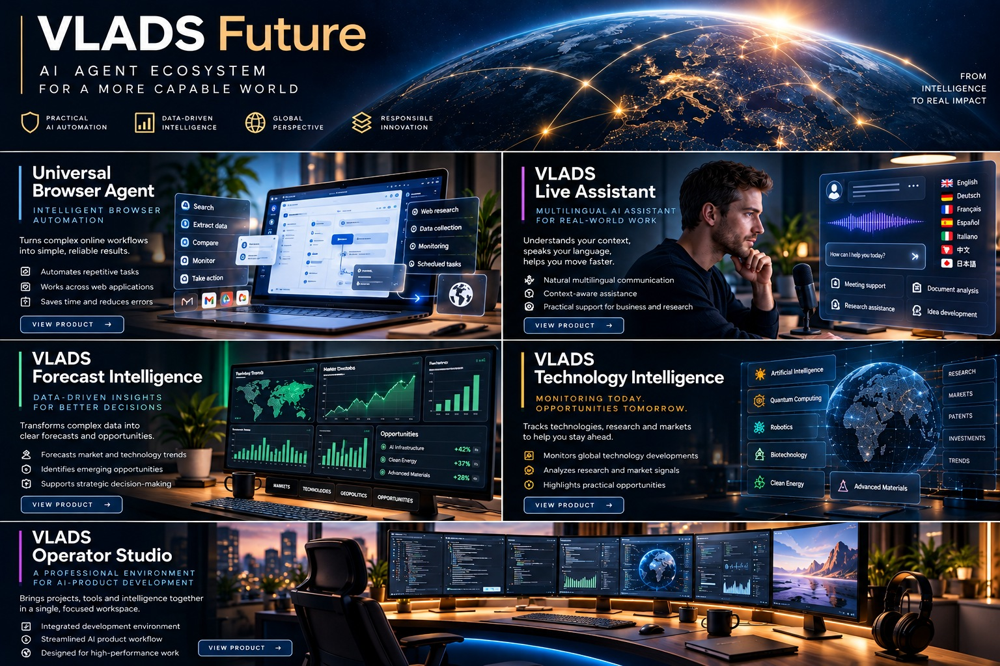

# VLADS Future | Product Portfolio

**Secure AI systems - Intelligent automation - Applied AI engineering**

A curated view of selected VLADS Future engineering initiatives. The projects are developed and validated privately; this repository intentionally exposes only portfolio-level descriptions, conceptual artwork, and carefully bounded engineering claims.

[Engineering profile](https://github.com/vladislavnaidenkopro-code) | [LinkedIn](https://www.linkedin.com/in/vladislav-naydenko/)

---

## What this portfolio demonstrates

Across the initiatives below, the engineering work concentrates on a recurring set of problems:

- **Controlled AI workflows** - clear operator authority, bounded actions, and explicit review points.
- **Reliability and recoverability** - predictable execution, durable state, and failure-aware workflows.
- **Applied AI systems** - multilingual assistance, research pipelines, forecasting workflows, and structured intelligence.
- **Operator experience** - interfaces that keep context, task state, and consequential decisions visible.
- **Evidence discipline** - separating intended product direction from capabilities that have been privately validated.

## Product landscape

| Initiative | Focus | Public status |
| --- | --- | --- |
| [Universal Browser Agent](products/universal-browser-agent.md) | Supervised browser automation | Private validation |
| [VLADS Live Assistant](products/vlads-live-assistant.md) | Multilingual live assistance | Pre-release validation |
| [VLADS Forecast Intelligence](products/vlads-forecast-intelligence.md) | Research, scenario analysis, and decision support | Private validation |
| [VLADS Technology Intelligence](products/vlads-technology-intelligence.md) | Technology monitoring and structured research | Private validation |
| [VLADS Operator Studio](products/vlads-operator-studio.md) | Operator-centered AI workspace | Private validation |

## Evidence discipline

Public descriptions are intentionally conservative. They distinguish **intended use cases**, **engineering themes**, and **private validation scope**. This repository does not publish internal test artifacts or use private validation as a substitute for independent certification.

No public claim is made here for general availability, production certification, autonomous operation, investment performance, independently verified accuracy, or a specific performance level.

## Public engineering showcase

### [Hardware-Attested AI Agent Runtime](https://github.com/vladislavnaidenkopro-code/hardware-attested-ai-agent-runtime)

A bounded engineering showcase exploring security-oriented AI-agent execution and confidential-computing concepts. It is a public portfolio artifact, not a production product release or a distribution of proprietary VLADS Future implementations.

## Independent research

**[AI-Agent Execution Assurance](https://doi.org/10.5281/zenodo.23784545)** — Independently published, reproducible research using bounded countermodels to examine authorization, idempotency, and audit-log continuity for AI-agent execution.

[Scientific preprint](https://doi.org/10.5281/zenodo.23784545) · [Reproducible software archive](https://doi.org/10.5281/zenodo.23783618) · [Research repository](https://github.com/vladislavnaidenkopro-code/agent-execution-assurance)

This preprint is not peer-reviewed. Its finite-model findings do not establish production security guarantees or certify proprietary VLADS Future systems.

## Collaboration

Relevant engineering discussions, design-partner conversations, and role-related conversations are welcome through [LinkedIn](https://www.linkedin.com/in/vladislav-naydenko/).

## Disclosure

This repository contains **public-safe portfolio material only**. Commercial source code, proprietary algorithms, internal architecture, security mechanisms, credentials, deployment procedures, private evidence, and operational configuration remain private.

See [Public Disclosure Policy](PUBLIC_DISCLOSURE.md) for the publication boundary used by this repository.

Copyright 2026 Vladislav Naidenko. Product descriptions and conceptual artwork are provided for portfolio purposes; no license to proprietary implementations is granted.