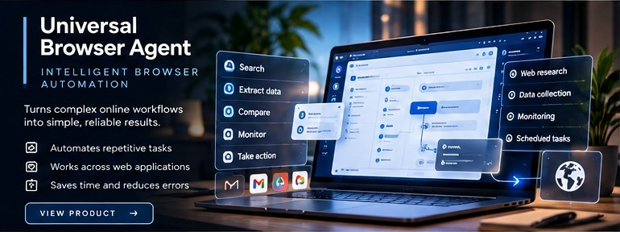

# Universal Browser Agent

**Focus:** Supervised browser automation for practical digital workflows.

**Public status:** Private validation

## Product overview

Universal Browser Agent explores how AI-assisted browser work can reduce repetitive navigation and information-handling effort while preserving explicit operator control over consequential actions.

## Intended use cases

- Cross-site research and structured information gathering.
- Repetitive administrative browser workflows.
- Operator-reviewed preparation of browser actions.
- Multi-step workflows where context must remain visible across pages.

## Engineering themes

- Bounded browser observation and action surfaces.
- Human review around consequential operations.
- Predictable task state and failure handling.
- Separation between assistance, preparation, and execution authority.

## Private validation scope

Private engineering validation has exercised supervised browser workflows, read-oriented browser interaction paths, operator review boundaries, and native desktop integration. These statements describe internal validation scope, not unattended production reliability or universal website support.

## Availability and disclosure

This initiative is not advertised as generally available. Detailed implementations, supported-site matrices, internal security controls, deployment configuration, and private validation evidence are not published.

[Back to product portfolio](../README.md)