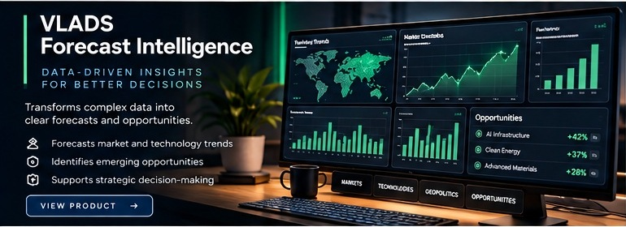

# VLADS Forecast Intelligence

**Focus:** AI-assisted research, scenario analysis, and decision support.

**Public status:** Private validation

## Product overview

VLADS Forecast Intelligence is a research-oriented workspace for combining source data, historical context, model outputs, scenarios, and uncertainty into a decision-support process that remains inspectable by an analyst.

## Intended use cases

- Market and macro research.
- Scenario comparison and hypothesis review.
- Historical-data analysis.
- Decision-support reporting and research communication.

## Engineering themes

- Reproducible ingestion and transformation of research data.
- Explicit treatment of assumptions and uncertainty.
- Historical evaluation before stronger forecasting claims.
- Separation of research support from automated trading or guaranteed predictions.

## Private validation scope

Private validation has exercised controlled real-source ingestion, historical dataset processing, reproducible research workflows, and multi-model analysis. This does not establish investment performance, independently verified predictive accuracy, or suitability for automated trading.

## Availability and disclosure

This initiative is not advertised as generally available. Proprietary models, private datasets, internal evaluation evidence, deployment configuration, and unreleased forecasts remain private.

[Back to product portfolio](../README.md)