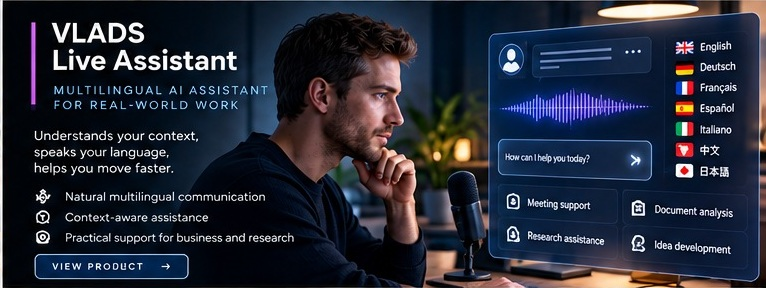

# VLADS Live Assistant

**Focus:** Multilingual AI assistance for interviews and live professional conversations.

**Public status:** Pre-release validation

## Product overview

VLADS Live Assistant is an operator-facing desktop workflow for following live conversations, organizing context, and preparing relevant response support across languages.

## Intended use cases

- Interview preparation and live interview support.
- Multilingual and mixed-language professional conversations.
- Contextual summaries and question tracking.
- Operator-guided response preparation.

## Engineering themes

- Offline-capable speech-processing workflows.
- Multilingual and mixed-language handling.
- Desktop runtime lifecycle and session control.
- Privacy-conscious operator interaction.

## Private validation scope

Pre-release engineering validation has exercised multilingual desktop workflows, offline speech-processing paths, runtime lifecycle behavior, and operator-facing interaction patterns. No claim is made here for universal transcription accuracy, invisible operation, recording consent, or production readiness.

## Availability and disclosure

This initiative is not advertised as generally available. Models, implementation details, internal privacy controls, binaries, private test results, and deployment configuration remain private.

[Back to product portfolio](../README.md)