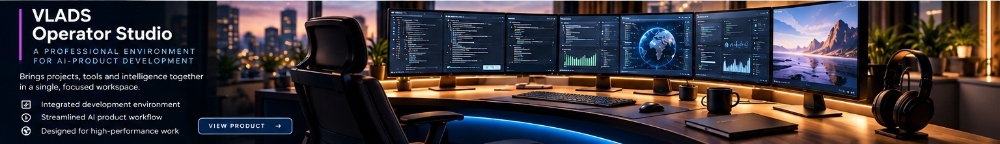

# VLADS Operator Studio

**Focus:** An AI operations workspace focused on operator experience.

**Public status:** Private development

## Product overview

An AI operations workspace focused on operator experience.

## Intended use cases

Workflow oversight, task review, multi-panel operations, and operator-centered research.

## Design focus

The design direction emphasizes task visibility, coherent context, and human decision authority.

These are product-direction descriptions, not claims of general availability or independently verified performance.

## Availability and disclosure

This initiative is not advertised as generally available. Detailed implementations, product internals, security mechanisms, operational configurations, and private evaluation evidence are not published.

[Back to product portfolio](../README.md)
