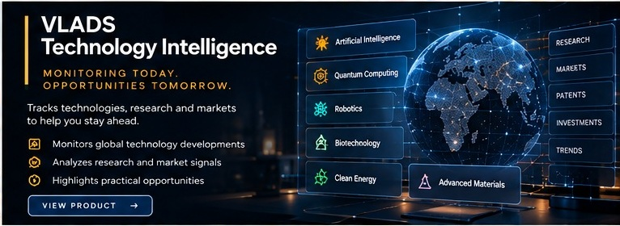

# VLADS Technology Intelligence

**Focus:** Technology monitoring, structured research, and signal assessment.

**Public status:** Private validation

## Product overview

VLADS Technology Intelligence organizes fragmented technical information into a research workflow for identifying relevant developments, comparing approaches, and preparing decision-oriented briefs.

## Intended use cases

- Competitive technology scanning.
- Technical trend and research reviews.
- Opportunity mapping and structured briefs.
- Monitoring changes across selected research sources.

## Engineering themes

- Structured multi-source research ingestion.
- Deduplication and canonicalization of repeated records.
- Continuation and pagination handling for larger result sets.
- Provenance-aware research organization.

## Private validation scope

Private validation has exercised multi-page research-source ingestion, duplicate handling, continuation workflows, and provenance-oriented processing. These statements do not imply exhaustive coverage, exclusive data access, real-time monitoring of every source, or automated truth verification.

## Availability and disclosure

This initiative is not advertised as generally available. Source-selection logic, internal ranking, private evidence, deployment configuration, and proprietary implementation remain private.

[Back to product portfolio](../README.md)